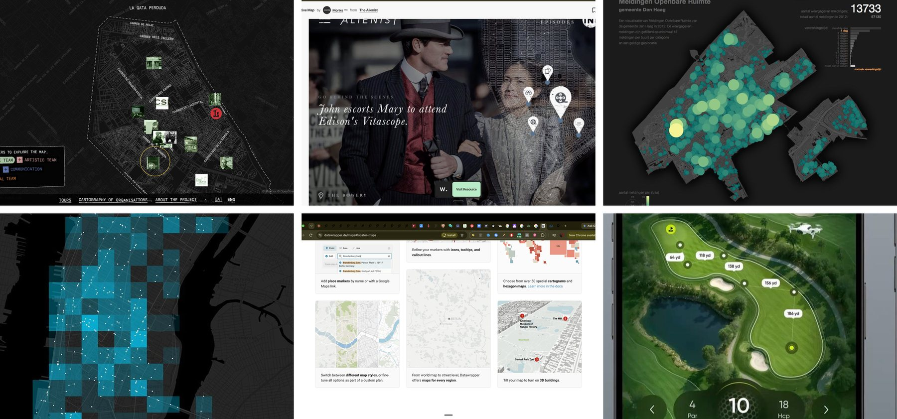
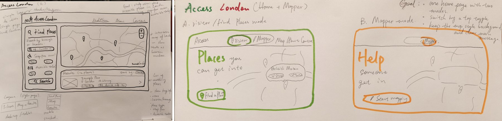
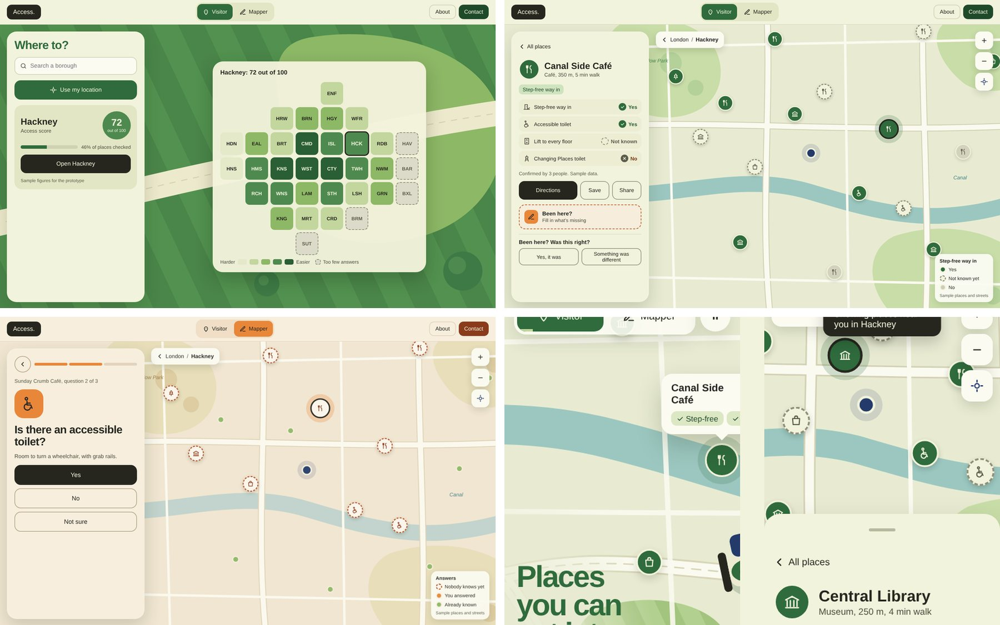
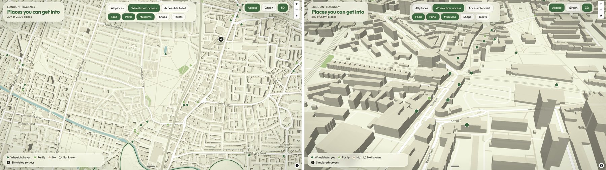
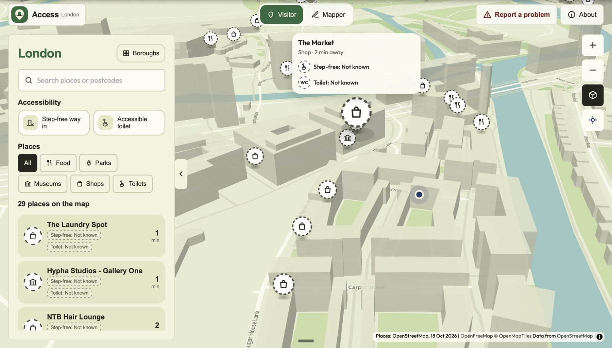
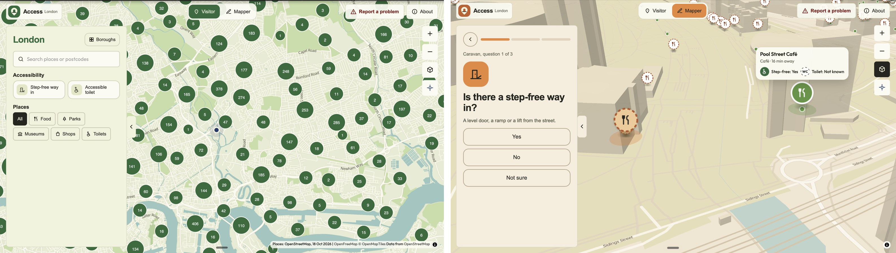

### 2.1.1 UI/UX Design and Page Layout

**Who we design for.** Access London is for disabled people and people with access needs, mainly wheelchair users and anyone who cannot manage steps, including people with a pushchair or an injury. 13.2% of Londoners are disabled, from 10.7% in the City of London to 16.2% in Islington (Trust for London, 2023). Access information decides whether many go out at all: 91% look for it before visiting somewhere new, and 58% avoid a venue that has not published it (Euan's Guide, 2022). We turned this research into six questions a disabled person asks before a trip (Table 1), and used them to decide what each screen must answer. The site covers five kinds of everyday place where knowing about the entrance and the toilet decides whether a trip happens: food and drink, parks, museums and galleries, shops, and public toilets.

| Question | How Access London answers it |
|---|---|
| 1 What do I need? | Need filters, combined with kinds of place |
| 2 Can I get there? | Nearest step-free stations, and a walking or wheelchair route |
| 3 Can I get in? | The first line of every place card |
| 4 Can I use it inside? | The next rows of the card, and the hover card |
| 5 Can I rest? | Toilets only; benches are future work |
| 6 Can I trust it? | Shown only when two people agree; simulated data is labelled |

*Table 1: The six questions behind our design.*

**References and storyboard.** Story maps such as La Gata Perduda and the interactive map for The Alienist put picture pins on a quiet base map, so the places carry the story (Figure 1). Grid maps such as Meldingen Openbare Ruimte showed how equal tiles let areas be compared fairly, which became our borough tile map, and GolfX showed a map-first phone layout with a sliding panel. Our first sketch (Figure 2, left) was one page: filters, a map and a list of results. The second split the site into two modes, switched in the header: Visitor in green and Mapper in orange. A high-fidelity prototype with sample data (Figure 3) then fixed the visual language before real data was connected: a cream base map, pins in three states, and cards with large touch targets.

*Figure 1: Design references. Top: La Gata Perduda, The Alienist interactive map, Meldingen Openbare Ruimte. Bottom: a grid map of cyclists, Datawrapper locator maps, GolfX. Screenshots from each project's public website or app.*

*Figure 2: Storyboard sketches. Left: the single-page layout. Right: the two modes, Visitor and Mapper.*

*Figure 3: High-fidelity prototype with sample data.*

**Page layout.** The map fills the screen and everything else floats over it (Figure 5). A header holds the logo, the Visitor/Mapper switch, "Report a problem" and About. A panel on the left holds search, the need and place filters, and the results, and it collapses for a map-only view. Zoom, 3D and "Use my location" sit on the right. Visitor mode uses greens on cream; Mapper mode turns the whole interface terracotta and orange, so it is always clear which task the user is doing. We used one typeface (Outfit), rounded floating cards with soft shadows, and one icon set for kinds of place and access features.

**Accessibility of the interface.** A site about access has to be accessible itself. Following WCAG 2.2 (W3C, 2023), touch targets are at least 44 pixels, keyboard focus is visible, every icon has a text label, every control has a name for screen readers, and colour is never used alone: unknown places are dashed as well as uncoloured.

**User testing.** Three people tested the site with three tasks based on the user research (Table 2).

| Task | Question | What happened |
|---|---|---|
| Trying all the keys and navigation on the entire website. Flow and experience of the website | 1, 2, 3 | User found the navigation to be smooth, visual language also good but suggested icons could help identify types, more legibility, smoother transition. |
| Check whether a museum has an accessible toilet | 4 | Typing a museum name showed info about the accessibility requirements. Suggested to add a report/ help option. |
| Add what you know about a place you have been to | Mapper | Found the questionnaire idea pretty easy and effortless. After answering the questions, it was not immediately updated because it requires 2 people to verify/ add information to that one place. |

*Table 2: User-testing tasks and results.*

From these results we changed the buttons, navigation, legibility, icon sizes and place cards. Pins now carry an icon for each kind of place, and the final site has a "Report a problem" button. The Mapper result shows the cost of the two-agree rule, so the card tells contributors that one more answer will confirm theirs.

Namita led the visual and interaction design: she wrote specifications for each screen from the sketches and prototype, reviewed every version, and listed the bugs and changes for the next. Most of the front-end code was generated with Claude (Anthropic) from these specifications, as recorded in our AI-use log.

### 2.1.2 Interactive Map and Data Visualisation

**From the first build to the final map.** The first build on real data (Figure 4) covered Hackney only. Every place was the same small dot, and the detailed base map competed with the data. For the final map we moved from Leaflet's fixed image tiles to MapLibre with OpenStreetMap vector tiles, so we could restyle every layer in our own calm colours and add 3D buildings.

*Figure 4: The first build on real data: Hackney only, in 2D (left) and 3D (right).*

**Two maps.** The first map shows London's 33 boroughs as equal tiles, so a small borough counts as much as a large one. In Visitor mode a darker tile means a higher score, and a dashed tile means too few places have been checked for a fair score. In Mapper mode a darker tile means more information is missing. On the geographic map, places are grouped into numbered clusters at city scale and split into pins as the user zooms in (Figure 6, left), so 74,500 places stay readable.

**Pins.** A pin's icon shows the kind of place and its colour the answer: green for yes, grey for no or partly, and dashed for not known, a code similar to Wheelmap's (Mobasheri et al., 2017). Missing information looks missing, never like "no": about 87% of places have no wheelchair tag, and drawing them grey would tell users that most of London is closed to them. In Mapper mode the gaps become dashed terracotta pins, a place with one answer turns light orange, and a confirmed place turns green (Figure 6, right). Pins float above a soft shadow and grow when pointed at.

**Cards and lists.** Pointing at a pin opens a hover card with the name, the walking time from the user and the access answers, which replaced a separate legend (Figure 5). Clicking opens the place card, which leads with the answers that decide a trip: step-free way in, accessible toilet and lift, in words as well as colour. The panel lists the places in view, sorted by walking time, and the need and place filters can be combined.

*Figure 5: The final map in 3D, with the hover card for a shop and the list of nearby places.*

*Figure 6: Left: London at city scale, with places grouped into clusters. Right: Mapper mode, with a gap being answered and a confirmed place in green.*
