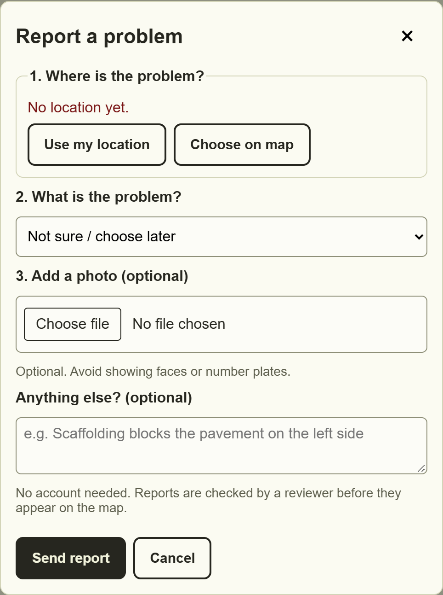
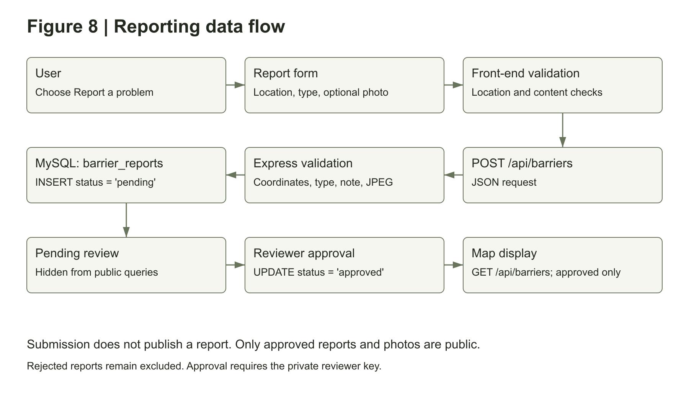

### 2.1.3 User Interaction and Reporting Features

Access London provides two routes for users to correct accessibility information. For street barriers, `openReport()` launches a native `<dialog>` from the header, a place card or a planned route (Figure 7). Users select a location through geolocation or a map click, then supply at least one of a problem type, note or photograph. An `aria-live` region communicates errors, while `submit()` sends JSON to `POST /api/barriers`. Valid submissions remain `pending` until a reviewer approves them (Figure 8).

*Figure 7: Reporting interface.*

*Figure 8: Reporting and moderation flow.*

Testing revealed that the interface rejected empty reports but the server initially accepted them. The API now enforces the same content rule, as client-side validation can be bypassed (OWASP, n.d.). A separate place-card flow had a more misleading failure: selecting “Closed” or “Something else” displayed a thank-you message without saving anything. These options now use `POST /api/place-flags`; success is shown only after the server responds, and a partial-failure retry resends only missing flags.

However, place flags cannot yet be reviewed or reflected on the map, and “Something else” has no explanation field. Map-based location selection also lacks a keyboard equivalent. The revised messages distinguish a recorded observation from a verified change to public accessibility information.
