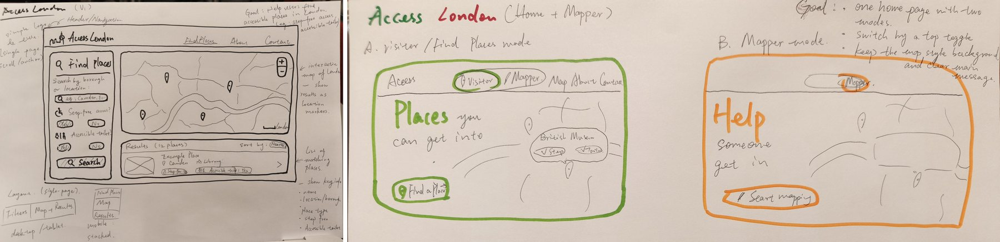
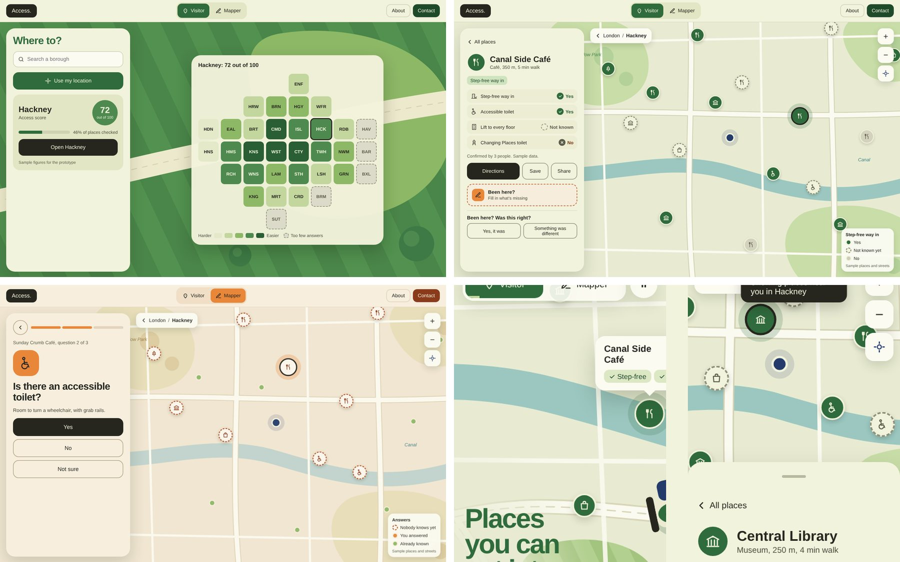
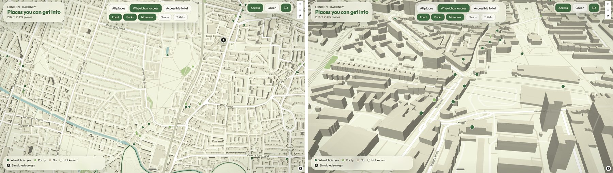
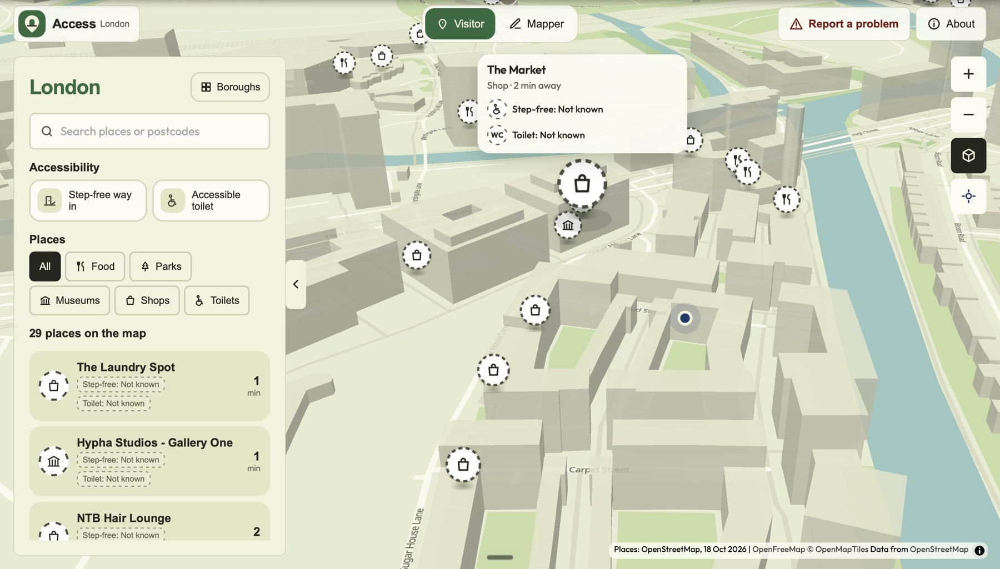
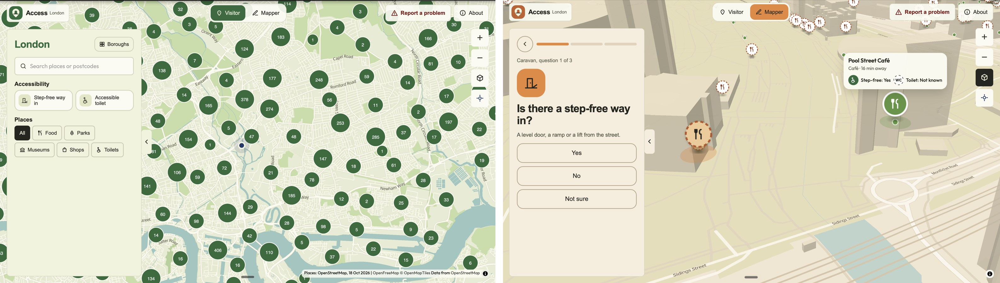
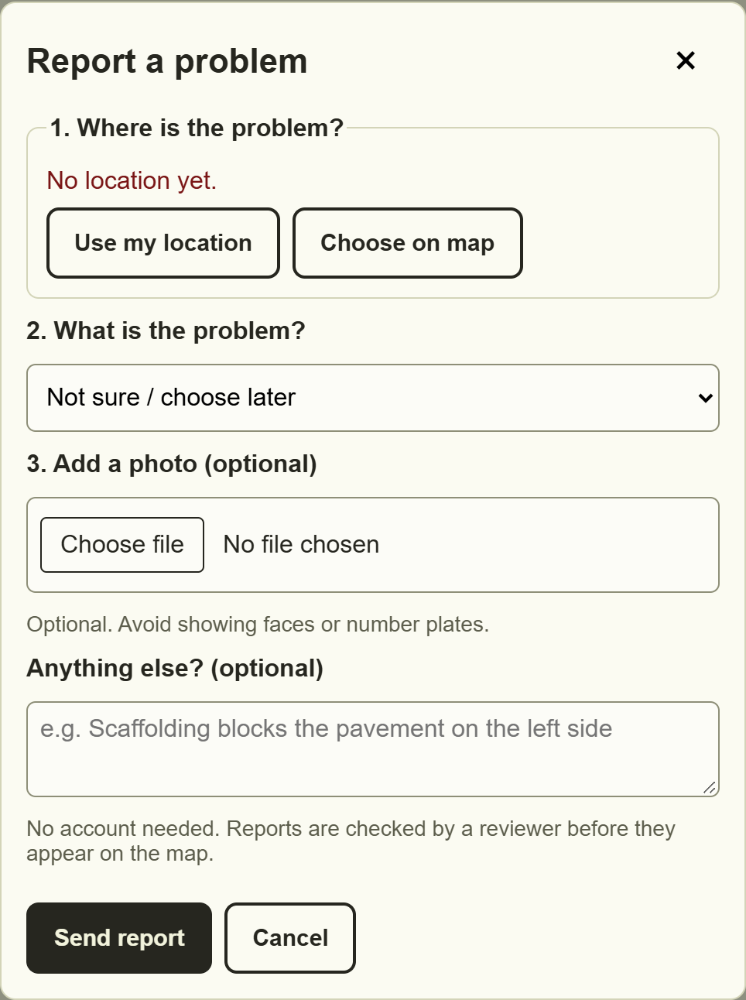
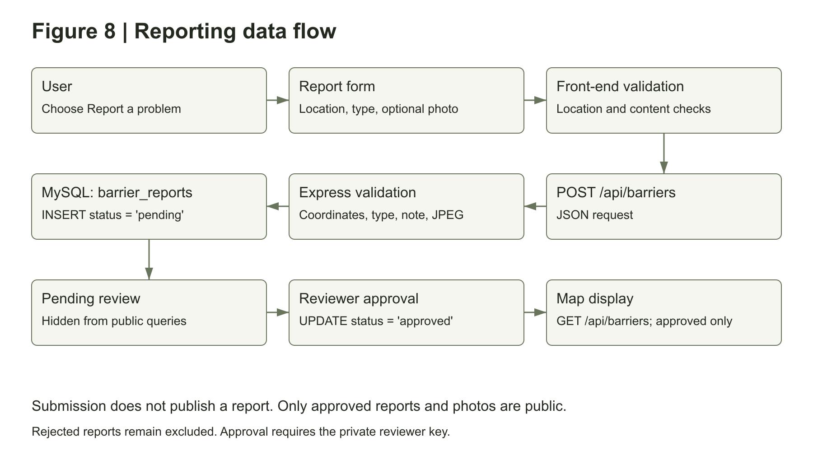
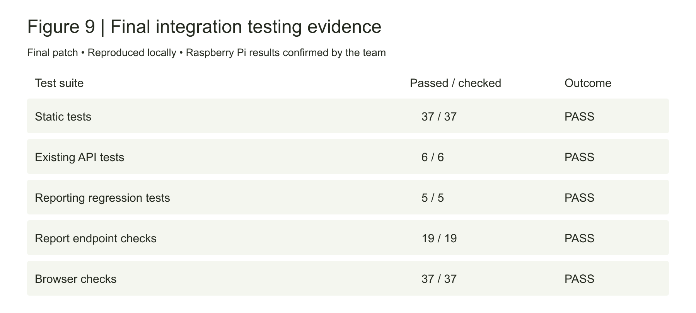
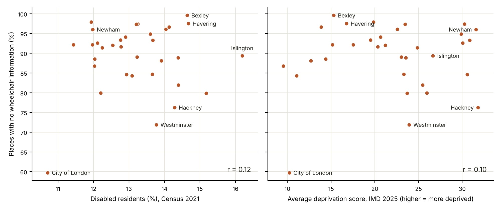

# Access London

## Final Group Report

**Module:** UCL CASA0017 — Web Architecture

**Team:** the-DOMinators

**Website:** [Access London on PiCloud](http://10.129.111.36:3000/) (UCL network access required)

**Repository:** [Echi-J/the-DOMinators](https://github.com/Echi-J/the-DOMinators)

## Table of Contents

- [1 Introduction](#1-introduction)
  - [1.1 Background](#11-background)
  - [1.2 Motivation](#12-motivation)
  - [1.3 Aims and Objectives](#13-aims-and-objectives)
  - [1.4 Project Overview](#14-project-overview)
- [2 Front-end Development](#2-front-end-development)
  - [2.1 Front-end Development](#21-front-end-development)
    - [2.1.1 UI/UX Design and Page Layout](#211-uiux-design-and-page-layout)
    - [2.1.2 Interactive Map and Data Visualisation](#212-interactive-map-and-data-visualisation)
    - [2.1.3 User Interaction and Reporting Features](#213-user-interaction-and-reporting-features)
    - [2.1.4 Front-end Integration and Testing](#214-front-end-integration-and-testing)
- [3 Back-end Development](#3-back-end-development)
  - [3.1 Data preparation and processing](#31-data-preparation-and-processing)
  - [3.2 Connecting the source data to the database](#32-connecting-the-source-data-to-the-database)
  - [3.3. Backend testing and validation](#33-backend-testing-and-validation)
- [4 Simulated Data and the database](#4-simulated-data-and-the-database)
  - [4.1 Simulated survey data](#41-simulated-survey-data)
  - [4.2 From a static file to a database](#42-from-a-static-file-to-a-database)
  - [4.3 Sending and reading answers](#43-sending-and-reading-answers)
  - [4.4 Deployment](#44-deployment)
- [5 Findings](#5-findings)
- [6 Limitations](#6-limitations)
- [7 Conclusion and future work](#7-conclusion-and-future-work)
- [Bibliography](#bibliography)
- [Declaration of Authorship](#declaration-of-authorship)

---

## 1 Introduction

### 1.1 Background

According to the 2021 Census, approximately 1.16 million London residents were disabled (Greater London Authority, 2026). For wheelchair users and people with reduced mobility, planning a visit may require information about entrances, toilets and conditions along the route. However, Transport for All found that 46% of disabled respondents in England experienced difficulty finding information in advance for walking or wheeling journeys (Johnson et al., 2023, p. 28). Research examining 212 urban rail systems worldwide also identified unclear or insufficient accessibility information, particularly about station surroundings and transfers (Ferreira et al., 2020). These findings highlight the importance of information that helps people assess both their destination and the journey, while recognising that accessibility needs vary between individuals.

### 1.2 Motivation

Access London developed from the team's interest in making accessibility information easier to explore and contribute to. The project focuses on wheelchair users and people with reduced mobility in London, while allowing other residents and visitors to share observations. Existing platforms such as Wheelmap demonstrate how users can find places and contribute wheelchair accessibility ratings through a map interface (Sozialhelden, n.d.).

During data preparation, the team found that many places in the selected OpenStreetMap dataset lacked wheelchair accessibility information. OpenStreetMap specifies no default value for wheelchair access, so an absent tag cannot establish whether a place is accessible (OpenStreetMap contributors, n.d.). This distinction shaped the project: displaying existing records alone would leave many questions unanswered.

The team therefore developed two connected functions: helping visitors explore available information and enabling contributors to fill gaps or flag discrepancies. A borough overview places individual records in a wider context by showing recorded accessibility alongside data coverage. Suggested routes and street barrier reporting extend the focus beyond destinations to conditions encountered along a journey. Together, these choices connect information use with opportunities to improve it.

### 1.3 Aims and Objectives

The primary aim of Access London is to develop a web application that supports informed travel decisions for wheelchair users and people with reduced mobility in London. The objectives are:

1. To bring place information together in an interactive map, with searches and filters for relevant accessibility features.
2. To provide suggested walking and wheelchair routes, alongside information about reported street barriers.
3. To enable users to contribute observations about step-free entrances, accessible toilets and lifts, and flag discrepancies in existing records.
4. To communicate missing information and uneven data coverage through place records and a borough overview.

These objectives guide the platform towards supporting individual decisions while making the limitations of the available evidence visible.

### 1.4 Project Overview

Access London combines Visitor and Mapper modes within a map-based interface. Visitor mode supports place searches, accessibility filters and route suggestions. Mapper mode provides a short questionnaire for contributing missing accessibility information. Users can also report street barriers and discrepancies in place records. A complementary borough view summarises recorded wheelchair accessibility, withholding scores where coverage is insufficient. The application connects these interactions to stored place records and user submissions. Route suggestions and borough scores are presented with qualifications about data coverage and conditions on the ground.

## 2 Front-end Development

### 2.1 Front-end Development

#### 2.1.1 UI/UX Design and Page Layout

Access London prioritises wheelchair users and people who cannot manage steps. Census-based figures indicate that 13.2% of Londoners are disabled (Trust for London, 2023). In Euan's Guide's 2022 survey, 91% of respondents sought access information before visiting somewhere new and 58% avoided venues without it (Euan's Guide, 2022). We translated these concerns into six design questions (Table 1), focusing on food and drink, parks, cultural venues, shops and toilets.

| Question | How Access London answers it |
|---|---|
| 1 What do I need? | Need filters, combined with kinds of place |
| 2 Can I get there? | Nearest step-free stations, and a walking or wheelchair route |
| 3 Can I get in? | The first line of every place card |
| 4 Can I use it inside? | The next rows of the card, and the hover card |
| 5 Can I rest? | Toilets only; benches are future work |
| 6 Can I trust it? | Shown only when two people agree; simulated data is labelled |

*Table 1: The six questions behind our design.*

Map-first references informed our storyboard (Figures 1–2). The prototype distinguished green Visitor and terracotta Mapper modes against a cream background (Figure 3).

*Figure 1: Design references. Top: La Gata Perduda, The Alienist interactive map, Meldingen Openbare Ruimte. Bottom: a grid map of cyclists, Datawrapper locator maps, GolfX. Screenshots from each project's public website or app.*

*Figure 2: Storyboard sketches. Left: the single-page layout. Right: the two modes, Visitor and Mapper.*

*Figure 3: High-fidelity prototype with sample data.*

Search and filters sit beside the map. Visible focus, labels, non-colour cues and 44-pixel target sizes guided accessibility design without establishing full WCAG conformance (W3C, 2023). Table 2 summarises three testers' feedback.

| Task | Main feedback | Design response |
|---|---|---|
| Navigate the website | Navigation was smooth; icons and legibility needed improvement | Clearer icons, larger controls and revised cards |
| Find a museum's accessible toilet information | Information was discoverable; a reporting option was requested | Added a prominent reporting entry |
| Contribute accessibility answers | Questionnaire was straightforward; confirmation was not immediate | Explain the two-person confirmation rule |

*Table 2: Feedback from three testers and the resulting design changes.*

Namita led design specifications, prototypes and reviews; Claude generated most front-end code from these specifications.

#### 2.1.2 Interactive Map and Data Visualisation

The initial Hackney prototype used uniform dots over a detailed basemap (Figure 4). We moved to MapLibre vector rendering to control the visual hierarchy and add 3D buildings.

*Figure 4: The first build on real data: Hackney only, in 2D (left) and 3D (right).*

Equal-area tiles compare 33 boroughs: Visitor mode shows scores where coverage permits, while Mapper mode highlights gaps. Geographic clusters separate into individual pins as users zoom in (Figure 6).

Pin icons identify place categories. Green indicates yes, grey indicates no or partial access, and dashed uncoloured symbols indicate unknown information. Wheelmap provided a precedent for communicating accessibility through map symbols (Mobasheri, Deister and Dieterich, 2017). Keeping unknown distinct from inaccessible is essential because approximately 87% of source records lack usable wheelchair information.

Hover cards summarise access; selection opens entrance, toilet and lift details (Figure 5). Filters support discovery, while Mapper symbols distinguish gaps, provisional answers and confirmed contributions.

*Figure 5: The final map in 3D, with the hover card for a shop and the list of nearby places.*

*Figure 6: Left: London at city scale, with places grouped into clusters. Right: Mapper mode, with a gap being answered and a confirmed place in green.*

#### 2.1.3 User Interaction and Reporting Features

Access London separates street barriers from corrections to place information. "Report a problem" opens from the header, a place card or a route; place cards prefill their coordinates. The native `<dialog>` provides modal focus management (MDN, n.d.), while an `aria-live` status line communicates validation errors.

Reports require a location and at least one type, note or photo. Geolocation or map selection supplies coordinates; map selection lacks a keyboard equivalent. Photos are redrawn at a maximum of 1,100 pixels before JSON submission to `POST /api/barriers`. Reports remain pending until authorised approval (Figures 7–8). Server validation repeats the combined content rule because browser checks can be bypassed (OWASP, n.d.); empty reports now return HTTP 400.

*Figure 7: Reporting dialogue with location, type, optional photograph and submission controls.*

*Figure 8: Validated reports enter MySQL as pending; only approved reports become public.*

Previously, "Closed", "Something else" and Mapper's "It has closed" displayed confirmation without saving records. The new `POST /api/place-flags` endpoint stores them separately from street barriers. Confirmation now follows HTTP 201; failed requests retain the current step, and retries after partial success send only missing flags. Flags do not alter the public map, have no review action or per-person de-duplication, and "Something else" lacks a text field. Shared reviewer credentials, identifiable photographs and reports without expiry remain limitations.

#### 2.1.4 Front-end Integration and Testing

Express serves pages and `/api` routes from one origin. A successful report passes server validation, enters MySQL and returns HTTP 201 before the dialogue closes. Mapper answers have a localStorage retry queue; barrier reports and place flags do not.

Initial AI-assisted testing with Claude was independently rerun with Codex on Windows, Node 24.15.0, MySQL and Chrome 156. The team confirmed identical final results on the Raspberry Pi/MariaDB deployment (Table 3). Browser checks used simulated geolocation and locally supplied map resources. These automated checks are distinct from user testing.

| Test suite | Earlier result | Final result |
|---|---|---|
| Static | 28/28 | 37/37 |
| API | 6/6 | 6/6 |
| Reporting regression | 1/5 | 5/5 |
| Report endpoints | 18/19 | 19/19 |
| Browser | 20/24 | 37/37 |

*Table 3: Final results reproduced locally and confirmed on Raspberry Pi; earlier results were not independently repeated.*

*Figure 9: Final automated test results and team-confirmed Raspberry Pi results.*

Source-pattern tests passed despite runtime faults, motivating API regression and browser checks. Three browser fixes were verified: cancelling Escape's default action preserved the reopened form, allowing a duration parameter kept confirmation visible for 5.2 seconds, and handling network failures retained input with a clear error. Backend checks covered persistence, moderation, photo access and rate limiting.

Direct integration without consistent pull-request checks delayed discovery. The suites still require a running server and database and are not automated on every pull request. Real phones, cameras and screen readers remain outside the demonstrated test coverage.

## 3 Back-end Development

### 3.1 Data preparation and processing
Access London’s core place data came from a Greater London OpenStreetMap (OSM) snapshot dated 18 October 2026. We chose OSM because it provides locations, categories and accessibility tags within the same dataset. After cleaning, we retained 74,500 objects across London’s 33 local authority areas, covering food and drink venues, shops, parks, cultural venues and toilets. Borough boundaries from London Datastore (Greater London Authority, n.d.) were used to assign each object to an area.

Station information came from Transport for London’s (TfL) London Rail Accessibility Data (LRAD; Transport for London, n.d.), which describes stations’ usual step-free access arrangements. We matched station coordinates using previously downloaded StopPoint API data and imported 466 records with coordinates into the database. These support the nearby-station information in the place details panel. They are static records and do not reflect live lift disruptions.

We used Python to exclude objects explicitly marked as private or prohibited access, inactive objects, records without usable geometry, and objects that could not be assigned to the London study area. We also standardised names and postcodes and converted coordinates to longitude and latitude for the web map. In the core dataset, 64,972 objects, approximately 87.2%, had missing or unclassifiable wheelchair-access tags. We retained these as unknown, because missing information does not mean that a place is inaccessible.

Duplicate checks considered names, categories and distances. Suspected duplicates were flagged rather than automatically merged, since nearby objects may represent different parts of the same site. The cleaned files retained original names and source information so that records could be traced back to their sources.

### 3.2 Connecting the source data to the database
The cleaned JSON and GeoJSON files were used to populate the places, boroughs and stations tables. The website queries the database through a Node.js and Express API, with official borough codes linking places to their areas. Queries use a mysql2/promise connection pool and parameterised SQL. Database connection settings are read from environment variables on the server.

The map loads places within the area currently in view and supports filters for category, step-free entrance and accessible toilet. The main map queries and name search exclude records whose names were generated solely from a category and OSM identifier, leaving 69,891 objects available through these queries. The viewport endpoint returns up to 10,000 records per request and prompts users to zoom in when this limit is exceeded. These figures describe data objects and query coverage, rather than a verified count of distinct venues.

For entrance information, Mapper answers that meet the confirmation rule take priority. Where no confirmed answer is available, the page uses the OSM wheelchair-access tag. This provides a general indication of access but does not establish whether a particular entrance is step-free. Source records and user answers are stored separately, allowing the displayed information to change while preserving the original place records. The simulated responses, confirmation rule and deployment process are discussed in the following sections.
 
### 3.3. Backend testing and validation
Validation focused on whether data could be queried and saved correctly. Local checks compared imported record counts with the source files. The project includes API tests for invalid answers, repeated submissions from the same browser identifier, the confirmation rule, and map filtering and viewport limits.

Using a separate local MySQL database, we compared API responses with stored records to check persistence and public visibility. A test Mapper submission remained stored after refreshing the page. After applying the required database migration, a road-barrier report was saved as pending and excluded from public queries. It became publicly visible after approval. These checks examined the full process from submitting information to storing it and making it available to other users.
 
## 4 Simulated Data and the database

### 4.1 Simulated survey data

We had no actual user data before the website launch, so our test material was a set of 1,392 simulated responses. We used those data for testing the function of the Mapper and confirming its rules. This work began with the six selected places in Hackney with 200 responses. We then extended it to six more boroughs after the first simulated data successfully stored in the database and changed the frontend of the Visitor Map.

There were three principles behind the data. Firstly, we used real places(supplied by OpenStreetMap). Secondly, we only make fake answers to places with no accessibility information. Because we did not want to replace any real information. Thirdly, the responses should resemble answers from real people. The responses were generated by our Python script, with some people answering “not sure” and others disagreeing. Each simulated response was marked with an “is_simulated” tag in the database. We used this to make all the simulated data with different style in the front end design.

### 4.2 From a static file to a database

What led us to use a database was the fixed JSON file cannot really update and store users responses to the User Map. Initially, the frontend of the website will read the answers directly from the json file. We therefore stored the data in MySQL and use Node.js (Express) server connects it to the front end through an API, so the map will update as soon as the answers arrive.

The database contains five tables in total. The boroughs table, places table and stations table hold the base data imported from OpenStreetMap, London Datastore and TfL. We created the obstacle table and answers table to store the user’s barrier reports and the answers about one place. If the same person answers the 3 questions again, their existing row will be updated rather than create a new row. Because we want to make sure that the answers to one place is only can be confirmed when two people both agree.

Additionally, we set a rule that require at least two people give the same answer for a place in order to show “confirmed” in the User Map. We wrote this rule by three SQL views that each build on the one before:
·     View One splits every answers into one row per question and drops “not sure”.
·     View Two uses GROUP BY to count how many people gave each answer.
·     View Three uses HAVING to keep a question only when everyone who answered gave the same answer and at least two people gave it.

### 4.3 Sending and reading answers

Answers are sent to the server with POST /api/answers. The server will check whether the place exists and the format of answer is valid, and limits how often one connection can submit. In our website, the users are not required to log in for submitting answers. Instead, their browser creates a random id so we can tell different people apart.

The page reads the results back with GET /api/answers every 20 seconds, so answers confirmed by other people will appear on the Map automatically.

### 4.4 Deployment

Our website was deployed on the Raspberry Pi and connected to MariaDB that already built on the Pi Cloud(we used MySQL8 during the development stage). However, the Pi was on the university's internal network, so it was only reachable through the university's Wi-Fi. To let people open it outside the university, we set up Cloudflare Tunnel on the Pi, which gave us a public address for our website.

## 5 Findings

Of the 74,500 places, 64,972 (87.2%) have no wheelchair information in OpenStreetMap. To answer our research question, we compared for each of the 33 boroughs the share of places with no wheelchair information against the share of residents who are disabled (Census 2021, TS038; Office for National Statistics, n.d.) and the average deprivation score (IMD 2025; Ministry of Housing, Communities and Local Government, 2025) (Figure 10).

*Figure 10: Missing wheelchair information by borough, against the disability rate (left) and deprivation (right). Each dot is one of the 33 boroughs.*

Neither relationship is strong: r = 0.12 for the disability rate and r = 0.10 for deprivation. Islington has London's highest disability rate (16.2%) but an average gap (89.4% unknown). The clearer pattern is geographic. The largest gaps are in outer London, led by Bexley (99.6% unknown), Redbridge (97.9%) and Havering (97.5%), while central London has the most information: Westminster 71.9% and the City of London 59.7%.

So the answer to our question is no: missing information is not concentrated where more disabled people live. It is concentrated away from the centre, which suggests it follows where OpenStreetMap contributors are active rather than where the need is. That still matters, because Bexley and Havering have disability rates (14.6% and 14.7%) above London's 13.2%. It is also why Mapper mode shows gaps by borough: it sends contributors to where answers are missing most. With 33 boroughs this is a broad comparison; gaps may still follow deprivation at neighbourhood level, which we did not test.

## 6 Limitations

- **Coverage.** 87.2% of places have no wheelchair information, so most pins can only say "not known". The places come from a single OpenStreetMap snapshot (18 October 2026). Their tags were never checked on site, and a place may have changed since it was mapped.
- **Scope.** The site covers five kinds of everyday place. GP surgeries, pharmacies, hospitals and the needs of blind, Deaf and neurodivergent visitors are not included.
- **No real answers yet.** The Mapper rule was tested with 1,392 simulated answers, labelled on the site. No real answers had been collected by submission, so borough scores still rest mainly on OpenStreetMap tags.
- **Trust.** Without sign-in, one person using two devices can confirm an answer alone. The two-agree rule catches honest mistakes, not deliberate ones.
- **Routes.** The current route planner lists reported obstacles, but does not change the route to avoid them.
- **Approval delays.** Obstacle reports and photos only appear on the map after a reviewer approves them. This helps keep inappropriate or false content off the map, but delays information that users may need immediately.
- **Outdated reports.** The database does not update automatically when an obstacle is cleared. So outdated obstacles can remain on the map.

## 7 Conclusion and future work

Access London shows what is known about getting into 74,500 places in London, makes the 87% that is unknown visible, and gives anyone a quick way to fill a gap, with a two-agree rule in the database deciding when an answer is shown. Our findings show that the gaps follow geography more than need: they are largest in outer London, not where disabled Londoners are most concentrated. With more time we would:

- **Test with disabled people.** Our three testers improved navigation and legibility. The next round should be with wheelchair users and organisations such as Transport for All.
- **Cover more of the trip:** essential services such as GP surgeries and pharmacies, bus stops and National Rail stations, live TfL lift status, and kerb heights along routes.
- **Make answers harder to fake.** The two-agree rule catches honest mistakes, but one person on two devices can still confirm an answer. Sign-in, and photos of entrances checked by a reviewer as barrier reports already are, would make it stronger.
- **Test the findings at neighbourhood level,** not only by borough.
- **Keep obstacle reports current.** Let nearby users confirm whether an obstacle is still there, so reports can be checked and outdated ones removed from the map without relying only on reviewers.
- **Use obstacle reports in routing.** Improve the route planner so it can use current obstacle reports to suggest routes that avoid reported barriers, rather than only listing them.

## Bibliography

Euan's Guide (2022) *The Euan's Guide Access Survey 2022*. Available at: https://www.euansguide.com/media/11191572/2022-euansguideaccesssurvey.pdf (Accessed: 16 November 2026).

Ferreira, A.F., Akasaka, Y., Pinheiro, M.G. de O. and Chang, S.K.J. (2020) ‘Information as the first attribute of accessibility: A method for assessing the information provided by urban rail systems to tourists with reduced mobility’, Sustainability, 12(23), 10185. Available at: https://doi.org/10.3390/su122310185.

Greater London Authority (2026) Housing for disabled Londoners: An analysis of secondary data. Housing Research Note 12. Available at: https://data.london.gov.uk/housing/research-notes/hrn-12-2026-housing-for-disabled-londoners-an-analysis-of-secondary-data/ (Accessed: 15 November 2026).

Greater London Authority (n.d.) *London boroughs*. London Datastore. Available at: https://data.london.gov.uk/dataset/london-boroughs-e55pw (Accessed: 16 November 2026).

Johnson, E., Pathania, A., Pennick, K., Stewart, M., Stickland, C. and Vogelmann, E. (2023) Are we there yet? Barriers to transport for disabled people in 2023. Transport for All. Available at: https://www.transportforall.org.uk/blog/2023/12/05/are-we-there-yet-barriers-to-transport-for-disabled-people-in-2023/ (Accessed: 15 November 2026).

MDN (n.d.) *`<dialog>`: The Dialog element*. Mozilla. Available at: https://developer.mozilla.org/en-US/docs/Web/HTML/Element/dialog (Accessed: 16 November 2026).

Ministry of Housing, Communities and Local Government (2025) *English indices of deprivation 2025*. Available at: https://www.gov.uk/government/statistics/english-indices-of-deprivation-2025 (Accessed: 16 November 2026).

Mobasheri, A., Deister, J. and Dieterich, H. (2017) ‘Wheelmap: the wheelchair accessibility crowdsourcing platform’, *Open Geospatial Data, Software and Standards*, 2, article 27. Available at: https://doi.org/10.1186/s40965-017-0040-5 (Accessed: 16 November 2026).

Office for National Statistics (n.d.) *Disability: Census 2021, dataset TS038, version 3*. Available at: https://www.ons.gov.uk/datasets/TS038/editions/2021/versions/3 (Accessed: 16 November 2026).

OpenStreetMap contributors (n.d.) Key:wheelchair. Available at: https://wiki.openstreetmap.org/wiki/Key:wheelchair (Accessed: 15 November 2026).

OWASP (n.d.) *Input Validation Cheat Sheet*. OWASP Cheat Sheet Series. Available at: https://cheatsheetseries.owasp.org/cheatsheets/Input_Validation_Cheat_Sheet.html (Accessed: 16 November 2026).

Sozialhelden (n.d.) About Wheelmap. Available at: https://wheelmap.org/ (Accessed: 15 November 2026).

Transport for London (n.d.) *Step Free Data Specification for lrad-v2*. Available at: https://content.tfl.gov.uk/step-free-data-specification-for-lrad-v2.pdf (Accessed: 16 November 2026).

Trust for London (2023) *Census 2021 deep dive: disability and deprivation in London*. Available at: https://trustforlondon.org.uk/news/census-2021-deep-dive-disability-and-deprivation-in-london/ (Accessed: 16 November 2026).

W3C (2023) *Web Content Accessibility Guidelines (WCAG) 2.2*. Available at: https://www.w3.org/TR/WCAG22/ (Accessed: 16 November 2026).

## Declaration of Authorship
We, ALL AUTHORS NAME HERE, confirm that the work presented in this assessment is my own. Where information has been derived from other sources, I confirm that this has been indicated in the work.

Digitally Sign with Your name Here:
Mengjiao Zhao
Aubree Dai
Xinrui Li
Namita Senthil Kumaran
Zhaoji Huang
ASSESSMENT DATE 16/11

# Declaration of GenAI usage
This assessment falls under Category 3 of UCL's framework for generative AI in assessment: AI tools have an integral role. We used them as follows.
Claude (Anthropic): front-end code for the map, pins, place cards, home and About pages, generated from design specifications and reviewed; Node scripts that prepare map data; editing of report sections 2, 6 and 7; checking figures in the report against the data.
Chatgpt (OpenAi):  Back-end code assistance for the database and synthetic data. 

Every AI output was read, tested and edited by the group before use. The research question, design decisions, data choices and final text are our own, and we take responsibility for them.

