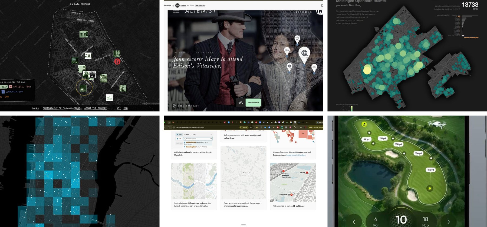
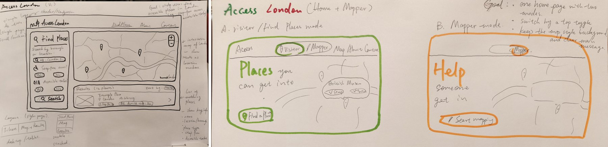
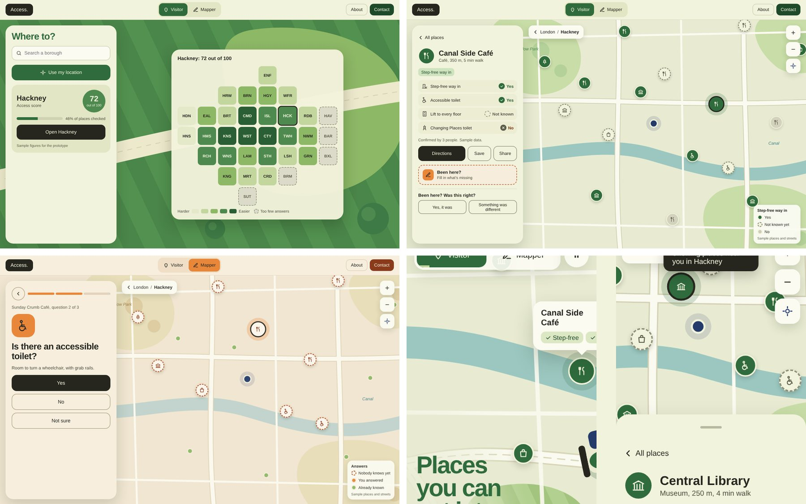
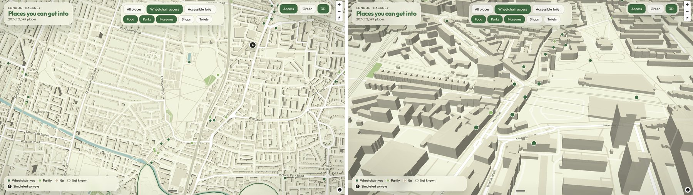
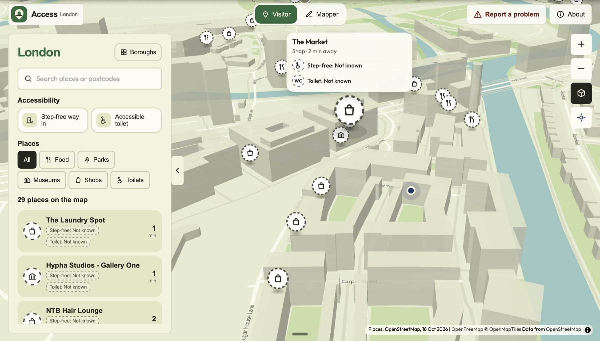
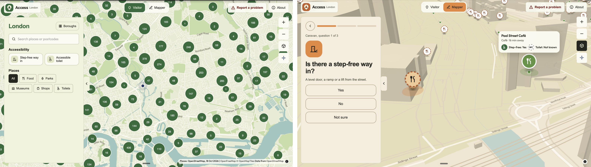
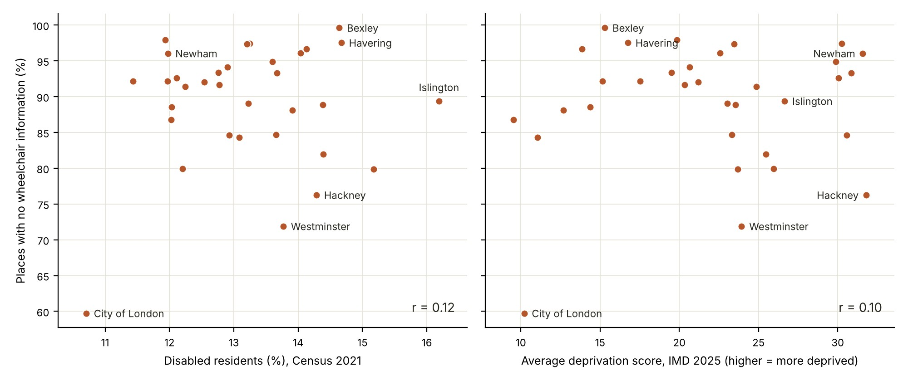

# 1 Introduction

## 1.1 Background

According to the 2021 Census, approximately 1.16 million London residents were disabled (Greater London Authority, 2026). For wheelchair users and people with reduced mobility, planning a visit may require information about entrances, toilets and conditions along the route. However, Transport for All found that 46% of disabled respondents in England experienced difficulty finding information in advance for walking or wheeling journeys (Johnson et al., 2023, p. 28). Research examining 212 urban rail systems worldwide also identified unclear or insufficient accessibility information, particularly about station surroundings and transfers (Ferreira et al., 2020). These findings highlight the importance of information that helps people assess both their destination and the journey, while recognising that accessibility needs vary between individuals.

## 1.2 Motivation

Access London developed from the team's interest in making accessibility information easier to explore and contribute to. The project focuses on wheelchair users and people with reduced mobility in London, while allowing other residents and visitors to share observations. Existing platforms such as Wheelmap demonstrate how users can find places and contribute wheelchair accessibility ratings through a map interface (Sozialhelden, n.d.).

During data preparation, the team found that many places in the selected OpenStreetMap dataset lacked wheelchair accessibility information. OpenStreetMap specifies no default value for wheelchair access, so an absent tag cannot establish whether a place is accessible (OpenStreetMap contributors, n.d.). This distinction shaped the project: displaying existing records alone would leave many questions unanswered.

The team therefore developed two connected functions: helping visitors explore available information and enabling contributors to fill gaps or flag discrepancies. A borough overview places individual records in a wider context by showing recorded accessibility alongside data coverage. Suggested routes and street barrier reporting extend the focus beyond destinations to conditions encountered along a journey. Together, these choices connect information use with opportunities to improve it.

## 1.3 Aims and Objectives

The primary aim of Access London is to develop a web application that supports informed travel decisions for wheelchair users and people with reduced mobility in London. The objectives are:

1. To bring place information together in an interactive map, with searches and filters for relevant accessibility features.
2. To provide suggested walking and wheelchair routes, alongside information about reported street barriers.
3. To enable users to contribute observations about step-free entrances, accessible toilets and lifts, and flag discrepancies in existing records.
4. To communicate missing information and uneven data coverage through place records and a borough overview.

These objectives guide the platform towards supporting individual decisions while making the limitations of the available evidence visible.

## 1.4 Project Overview

Access London combines Visitor and Mapper modes within a map-based interface. Visitor mode supports place searches, accessibility filters and route suggestions. Mapper mode provides a short questionnaire for contributing missing accessibility information. Users can also report street barriers and discrepancies in place records. A complementary borough view summarises recorded wheelchair accessibility, withholding scores where coverage is insufficient. The application connects these interactions to stored place records and user submissions. Route suggestions and borough scores are presented with qualifications about data coverage and conditions on the ground.

## 2.1 Front-end Development

### 2.1.1 UI/UX Design and Page Layout

**Who we design for.** Access London is for disabled people and people with access needs, mainly wheelchair users and anyone who cannot manage steps, including people with a pushchair or an injury. 13.2% of Londoners are disabled, from 10.7% in the City of London to 16.2% in Islington (Trust for London, 2023). Access information decides whether many go out at all: 91% look for it before visiting somewhere new, and 58% avoid a venue that has not published it (Euan's Guide, 2022). We turned this research into six questions a disabled person asks before a trip (Table 1), and used them to decide what each screen must answer. The site covers five kinds of everyday place where knowing about the entrance and the toilet decides whether a trip happens: food and drink, parks, museums and galleries, shops, and public toilets.

| Question | How Access London answers it |
|---|---|
| 1 What do I need? | Need filters, combined with kinds of place |
| 2 Can I get there? | Nearest step-free stations, and a walking or wheelchair route |
| 3 Can I get in? | The first line of every place card |
| 4 Can I use it inside? | The next rows of the card, and the hover card |
| 5 Can I rest? | Toilets only; benches are future work |
| 6 Can I trust it? | Shown only when two people agree; simulated data is labelled |

*Table 1: The six questions behind our design.*

**References and storyboard.** Story maps such as La Gata Perduda and the interactive map for The Alienist put picture pins on a quiet base map, so the places carry the story (Figure 1). Grid maps such as Meldingen Openbare Ruimte showed how equal tiles let areas be compared fairly, which became our borough tile map, and GolfX showed a map-first phone layout with a sliding panel. Our first sketch (Figure 2, left) was one page: filters, a map and a list of results. The second split the site into two modes, switched in the header: Visitor in green and Mapper in orange. A high-fidelity prototype with sample data (Figure 3) then fixed the visual language before real data was connected: a cream base map, pins in three states, and cards with large touch targets.

*Figure 1: Design references. Top: La Gata Perduda, The Alienist interactive map, Meldingen Openbare Ruimte. Bottom: a grid map of cyclists, Datawrapper locator maps, GolfX. Screenshots from each project's public website or app.*

*Figure 2: Storyboard sketches. Left: the single-page layout. Right: the two modes, Visitor and Mapper.*

*Figure 3: High-fidelity prototype with sample data.*

**Page layout.** The map fills the screen and everything else floats over it (Figure 5). A header holds the logo, the Visitor/Mapper switch, "Report a problem" and About. A panel on the left holds search, the need and place filters, and the results, and it collapses for a map-only view. Zoom, 3D and "Use my location" sit on the right. Visitor mode uses greens on cream; Mapper mode turns the whole interface terracotta and orange, so it is always clear which task the user is doing. We used one typeface (Outfit), rounded floating cards with soft shadows, and one icon set for kinds of place and access features.

**Accessibility of the interface.** A site about access has to be accessible itself. Following WCAG 2.2 (W3C, 2023), touch targets are at least 44 pixels, keyboard focus is visible, every icon has a text label, every control has a name for screen readers, and colour is never used alone: unknown places are dashed as well as uncoloured.

**User testing.** Three people tested the site with three tasks based on the user research (Table 2).

| Task | Question | What happened |
|---|---|---|
| Trying all the keys and navigation on the entire website. Flow and experience of the website | 1, 2, 3 | User found the navigation to be smooth, visual language also good but suggested icons could help identify types, more legibility, smoother transition. |
| Check whether a museum has an accessible toilet | 4 | Typing a museum name showed info about the accessibility requirements. Suggested to add a report/ help option. |
| Add what you know about a place you have been to | Mapper | Found the questionnaire idea pretty easy and effortless. After answering the questions, it was not immediately updated because it requires 2 people to verify/ add information to that one place. |

*Table 2: User-testing tasks and results.*

From these results we changed the buttons, navigation, legibility, icon sizes and place cards. Pins now carry an icon for each kind of place, and the final site has a "Report a problem" button. The Mapper result shows the cost of the two-agree rule, so the card tells contributors that one more answer will confirm theirs.

Namita led the visual and interaction design: she wrote specifications for each screen from the sketches and prototype, reviewed every version, and listed the bugs and changes for the next. Most of the front-end code was generated with Claude (Anthropic) from these specifications, as recorded in our AI-use log.

### 2.1.2 Interactive Map and Data Visualisation

**From the first build to the final map.** The first build on real data (Figure 4) covered Hackney only. Every place was the same small dot, and the detailed base map competed with the data. For the final map we moved from Leaflet's fixed image tiles to MapLibre with OpenStreetMap vector tiles, so we could restyle every layer in our own calm colours and add 3D buildings.

*Figure 4: The first build on real data: Hackney only, in 2D (left) and 3D (right).*

**Two maps.** The first map shows London's 33 boroughs as equal tiles, so a small borough counts as much as a large one. In Visitor mode a darker tile means a higher score, and a dashed tile means too few places have been checked for a fair score. In Mapper mode a darker tile means more information is missing. On the geographic map, places are grouped into numbered clusters at city scale and split into pins as the user zooms in (Figure 6, left), so 74,500 places stay readable.

**Pins.** A pin's icon shows the kind of place and its colour the answer: green for yes, grey for no or partly, and dashed for not known, a code similar to Wheelmap's (Mobasheri et al., 2017). Missing information looks missing, never like "no": about 87% of places have no wheelchair tag, and drawing them grey would tell users that most of London is closed to them. In Mapper mode the gaps become dashed terracotta pins, a place with one answer turns light orange, and a confirmed place turns green (Figure 6, right). Pins float above a soft shadow and grow when pointed at.

**Cards and lists.** Pointing at a pin opens a hover card with the name, the walking time from the user and the access answers, which replaced a separate legend (Figure 5). Clicking opens the place card, which leads with the answers that decide a trip: step-free way in, accessible toilet and lift, in words as well as colour. The panel lists the places in view, sorted by walking time, and the need and place filters can be combined.

*Figure 5: The final map in 3D, with the hover card for a shop and the list of nearby places.*

*Figure 6: Left: London at city scale, with places grouped into clusters. Right: Mapper mode, with a gap being answered and a confirmed place in green.*

## 3.1 Back-end Development

### 3.1.1 Data preparation and processing
Access London’s core place data came from a Greater London OpenStreetMap (OSM) snapshot dated 18 October 2026. We chose OSM because it provides locations, categories and accessibility tags within the same dataset. After cleaning, we retained 74,500 objects across London’s 33 local authority areas, covering food and drink venues, shops, parks, cultural venues and toilets. Borough boundaries from London Datastore were used to assign each object to an area.

Station information came from Transport for London’s (TfL) London Rail Accessibility Data (LRAD), which describes stations’ usual step-free access arrangements. We matched station coordinates using previously downloaded StopPoint API data and imported 466 records with coordinates into the database. These support the nearby-station information in the place details panel. They are static records and do not reflect live lift disruptions.

We used Python to exclude objects explicitly marked as private or prohibited access, inactive objects, records without usable geometry, and objects that could not be assigned to the London study area. We also standardised names and postcodes and converted coordinates to longitude and latitude for the web map. In the core dataset, 64,972 objects, approximately 87.2%, had missing or unclassifiable wheelchair-access tags. We retained these as unknown, because missing information does not mean that a place is inaccessible.

Duplicate checks considered names, categories and distances. Suspected duplicates were flagged rather than automatically merged, since nearby objects may represent different parts of the same site. The cleaned files retained original names and source information so that records could be traced back to their sources.

### 3.1.2. Connecting the source data to the database
The cleaned JSON and GeoJSON files were used to populate the places, boroughs and stations tables. The website queries the database through a Node.js and Express API, with official borough codes linking places to their areas. Queries use a mysql2/promise connection pool and parameterised SQL. Database connection settings are read from environment variables on the server.

The map loads places within the area currently in view and supports filters for category, step-free entrance and accessible toilet. The main map queries and name search exclude records whose names were generated solely from a category and OSM identifier, leaving 69,891 objects available through these queries. The viewport endpoint returns up to 10,000 records per request and prompts users to zoom in when this limit is exceeded. These figures describe data objects and query coverage, rather than a verified count of distinct venues.

For entrance information, Mapper answers that meet the confirmation rule take priority. Where no confirmed answer is available, the page uses the OSM wheelchair-access tag. This provides a general indication of access but does not establish whether a particular entrance is step-free. Source records and user answers are stored separately, allowing the displayed information to change while preserving the original place records. The simulated responses, confirmation rule and deployment process are discussed in the following sections.
 
### 3.1.3. Backend testing and validation
Validation focused on whether data could be queried and saved correctly. Local checks compared imported record counts with the source files. The project includes API tests for invalid answers, repeated submissions from the same browser identifier, the confirmation rule, and map filtering and viewport limits.

Using a separate local MySQL database, we compared API responses with stored records to check persistence and public visibility. A test Mapper submission remained stored after refreshing the page. After applying the required database migration, a road-barrier report was saved as pending and excluded from public queries. It became publicly visible after approval. These checks examined the full process from submitting information to storing it and making it available to other users.
 
## 3.2 Simulated Data and the database

### 3.2.1 Simulated survey data

We had no actual user data before the website launch, so our test material was a set of 1,392 simulated responses. We used those data for testing the function of the Mapper and confirming its rules. This work began with the six selected places in Hackney with 200 responses. We then extended it to six more boroughs after the first simulated data successfully stored in the database and changed the frontend of the Viewer Map.

There were three principles behind the data. Firstly, we used real places(supplied by OpenStreetMap). Secondly, we only make fake answers to places with no accessibility information. Because we did not want to replace any real information. Thirdly, the responses should resemble answers from real people. The responses were generated by our Python script, with some people answering “not sure” and others disagreeing. Each simulated response was marked with an “is_simulated” tag in the database. We used this to make all the simulated data with different style in the front end design.

### 3.2.2 From a static file to a database

During the development, What led us to use a database was the fixed JSON file cannot really update and store users responses to the User Map. Previously the page read its survey results directly from that fake data file. We therefore stored the data in MySQL and use Node.js (Express) server connects it to the front end through an API, so the map will update as soon as the answers arrive.

The database contains five tables in total. The boroughs table, places table and stations table hold the base data that imported from the OpenStreetMap. We created the obstacle table and answers table to store the user’s barrier reports and the answers about one place. If the same person answers the 3 questions again, their existing row will be updated rather than create a new row. Because we want to make sure that the answers to one place is only can be confirmed when two people both agree.

Additionally, a place’s answer is only shown “confirmed” when at least two different people give the same answer and nobody disagrees. We wrote this rule in the database itself, as three SQL views that each build on the one before:
·         View One splits every answers into one row per question and drops “not sure”.
·         View Two uses GROUP BY to count how many people gave each answer.
·         View Three uses HAVING to keep a question only when everyone who answered gave the same answer and at least two people gave it.

### 3.2.3 Sending and reading answers

Answers are sent to the server with POST /api/answers. The server checks that the place exists and that the answer is valid, and limits how often one connection can submit. In our website, the users are not required to log in for submitting answers. Instead, their browser creates a random id so we can tell different people apart.

The page reads the results back with GET /api/answers every 20 seconds, so answers confirmed by other people will appear on the Map automatically.

### 3.2.4 Deployment

Our website was deployed on the Raspberry Pi and connected to MariaDB that already built on the Pi Cloud(we used MySQL8 during the development stage). However, the Pi was on the university's internal network, so it was only reachable through the university's Wi-Fi. To let people open it outside the university, we set up Cloudflare Tunnel on the Pi, which gave us a public address for our website.

## 6 Findings

Of the 74,500 places, 64,972 (87.2%) have no wheelchair information in OpenStreetMap. To answer our research question, we compared for each of the 33 boroughs the share of places with no wheelchair information against the share of residents who are disabled (Census 2021) and the average deprivation score (IMD 2025) (Figure 8).

*Figure 8: Missing wheelchair information by borough, against the disability rate (left) and deprivation (right). Each dot is one of the 33 boroughs.*

Neither relationship is strong: r = 0.12 for the disability rate and r = 0.10 for deprivation. Islington has London's highest disability rate (16.2%) but an average gap (89.4% unknown). The clearer pattern is geographic. The largest gaps are in outer London, led by Bexley (99.6% unknown), Redbridge (97.9%) and Havering (97.5%), while central London has the most information: Westminster 71.9% and the City of London 59.7%.

So the answer to our question is no: missing information is not concentrated where more disabled people live. It is concentrated away from the centre, which suggests it follows where OpenStreetMap contributors are active rather than where the need is. That still matters, because Bexley and Havering have disability rates (14.6% and 14.7%) above London's 13.2%. It is also why Mapper mode shows gaps by borough: it sends contributors to where answers are missing most. With 33 boroughs this is a broad comparison; gaps may still follow deprivation at neighbourhood level, which we did not test.

## 7 Limitations

- **Coverage.** 87.2% of places have no wheelchair information, so most pins can only say "not known". The places come from a single OpenStreetMap snapshot (18 October 2026). Their tags were never checked on site, and a place may have changed since it was mapped.
- **Scope.** The site covers five kinds of everyday place. GP surgeries, pharmacies, hospitals and the needs of blind, Deaf and neurodivergent visitors are not included.
- **No real answers yet.** The Mapper rule was tested with 1,392 simulated answers, labelled on the site. No real answers had been collected by submission, so borough scores still rest mainly on OpenStreetMap tags.
- **Trust.** Without sign-in, one person using two devices can confirm an answer alone. The two-agree rule catches honest mistakes, not deliberate ones.
- **Routes.** Wheelchair routes depend on kerb and surface data in OpenStreetMap, which is often missing, so a suggested route may still contain barriers.
- **Testing.** Only three people tested the site, recruited informally, so the results show usability problems rather than whether the site meets disabled users' needs.
- **Findings.** The comparison uses 33 boroughs, which may hide patterns at neighbourhood level.

## 8 Conclusion and future work

Access London shows what is known about getting into 74,500 places in London, makes the 87% that is unknown visible, and gives anyone a quick way to fill a gap, with a two-agree rule in the database deciding when an answer is shown. Our findings show that the gaps follow geography more than need: they are largest in outer London, not where disabled Londoners are most concentrated. With more time we would:

- **Test with disabled people.** Our three testers improved navigation and legibility. The next round should be with wheelchair users and organisations such as Transport for All.
- **Cover more of the trip:** essential services such as GP surgeries and pharmacies, bus stops and National Rail stations, live TfL lift status, and kerb heights along routes.
- **Serve more people:** tactile paving, hearing loops and quiet times for blind, Deaf and neurodivergent visitors.
- **Make answers harder to fake.** The two-agree rule catches honest mistakes, but one person on two devices can still confirm an answer. Sign-in, and photos of entrances checked by a reviewer as barrier reports already are, would make it stronger.
- **Show how recent each answer is,** and ask Mappers to re-check old ones.
- **Test the findings at neighbourhood level,** not only by borough.

## Bibliography
Ferreira, A.F., Akasaka, Y., Pinheiro, M.G. de O. and Chang, S.K.J. (2020) ‘Information as the first attribute of accessibility: A method for assessing the information provided by urban rail systems to tourists with reduced mobility’, Sustainability, 12(23), 10185. Available at: https://doi.org/10.3390/su122310185.

Greater London Authority (2026) Housing for disabled Londoners: An analysis of secondary data. Housing Research Note 12. Available at: London Datastore (Accessed: 15 November 2026).
Johnson, E., Pathania, A., Pennick, K., Stewart, M., Stickland, C. and Vogelmann, E. (2023) Are we there yet? Barriers to transport for disabled people in 2023. Transport for All. Available at: Full report (Accessed: 15 November 2026).

OpenStreetMap contributors (n.d.) Key:wheelchair. Available at: OpenStreetMap Wiki (Accessed: 15 November 2026).

Sozialhelden (n.d.) About Wheelmap. Available at: Wheelmap (Accessed: 15 November 2026).

OWASP (n.d.) *Input Validation Cheat Sheet*. OWASP Cheat Sheet Series. Available at: https://cheatsheetseries.owasp.org/cheatsheets/Input_Validation_Cheat_Sheet.html (Accessed: 16 November 2026).

## Declaration of Authorship
We, ALL AUTHORS NAME HERE, confirm that the work presented in this assessment is my own. Where information has been derived from other sources, I confirm that this has been indicated in the work.

Digitally Sign with Your name Here
Mengjiao Zhao
Aubree Dai
Xinrui Li
ASSESSMENT DATE 16/11
