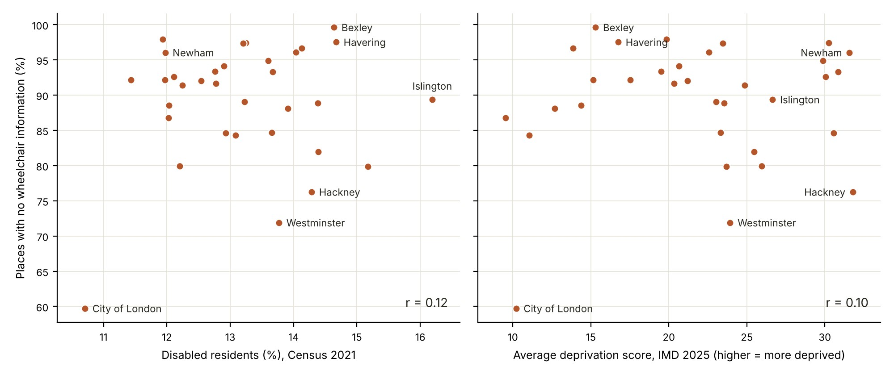

## 6 Findings

Of the 74,500 places, 64,972 (87.2%) have no wheelchair information in OpenStreetMap. To answer our research question, we compared for each of the 33 boroughs the share of places with no wheelchair information against the share of residents who are disabled (Census 2021) and the average deprivation score (IMD 2025) (Figure 8).

*Figure 8: Missing wheelchair information by borough, against the disability rate (left) and deprivation (right). Each dot is one of the 33 boroughs.*

Neither relationship is strong: r = 0.12 for the disability rate and r = 0.10 for deprivation. Islington has London's highest disability rate (16.2%) but an average gap (89.4% unknown). The clearer pattern is geographic. The largest gaps are in outer London, led by Bexley (99.6% unknown), Redbridge (97.9%) and Havering (97.5%), while central London has the most information: Westminster 71.9% and the City of London 59.7%.

So the answer to our question is no: missing information is not concentrated where more disabled people live. It is concentrated away from the centre, which suggests it follows where OpenStreetMap contributors are active rather than where the need is. That still matters, because Bexley and Havering have disability rates (14.6% and 14.7%) above London's 13.2%. It is also why Mapper mode shows gaps by borough: it sends contributors to where answers are missing most. With 33 boroughs this is a broad comparison; gaps may still follow deprivation at neighbourhood level, which we did not test.

## 7 Limitations

- **Coverage.** 87.2% of places have no wheelchair information, so most pins can only say "not known". The places come from a single OpenStreetMap snapshot (18 October 2026). Their tags were never checked on site, and a place may have changed since it was mapped.
- **Scope.** The site covers five kinds of everyday place. GP surgeries, pharmacies, hospitals and the needs of blind, Deaf and neurodivergent visitors are not included.
- **No real answers yet.** The Mapper rule was tested with 1,392 simulated answers, labelled on the site. No real answers had been collected by submission, so borough scores still rest mainly on OpenStreetMap tags.
- **Trust.** Without sign-in, one person using two devices can confirm an answer alone. The two-agree rule catches honest mistakes, not deliberate ones.
- **Routes.** Wheelchair routes depend on kerb and surface data in OpenStreetMap, which is often missing, so a suggested route may still contain barriers.
- **Testing.** Only three people tested the site, recruited informally, so the results show usability problems rather than whether the site meets disabled users' needs.
- **Findings.** The comparison uses 33 boroughs, which may hide patterns at neighbourhood level.

## 8 Conclusion and future work

Access London shows what is known about getting into 74,500 places in London, makes the 87% that is unknown visible, and gives anyone a quick way to fill a gap, with a two-agree rule in the database deciding when an answer is shown. Our findings show that the gaps follow geography more than need: they are largest in outer London, not where disabled Londoners are most concentrated. With more time we would:

- **Test with disabled people.** Our three testers improved navigation and legibility. The next round should be with wheelchair users and organisations such as Transport for All.
- **Cover more of the trip:** essential services such as GP surgeries and pharmacies, bus stops and National Rail stations, live TfL lift status, and kerb heights along routes.
- **Serve more people:** tactile paving, hearing loops and quiet times for blind, Deaf and neurodivergent visitors.
- **Make answers harder to fake.** The two-agree rule catches honest mistakes, but one person on two devices can still confirm an answer. Sign-in, and photos of entrances checked by a reviewer as barrier reports already are, would make it stronger.
- **Show how recent each answer is,** and ask Mappers to re-check old ones.
- **Test the findings at neighbourhood level,** not only by borough.
