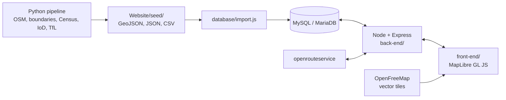

# Access London
**Find places you can actually get into. Help someone else get in.**

Access London is a web map of places across London that wheelchair users can get into: cafés, parks, museums, shops and public toilets. Anyone who has been to a place can fill in what's missing by answering three quick questions. No account is needed.

**The research problem:** most places on the map say nothing about access. We ask *is accessibility information missing where disabled Londoners live?* The site shows what is known for each of the 33 boroughs, says clearly what is not, and compares the gaps with the share of disabled residents (Census 2021) and deprivation (English Indices of Deprivation 2025).

Built by **The DOMinators** for CASA0017 Web Architecture, UCL Centre for Advanced Spatial Analysis.

**Live site:** _coming soon_


---

## What the website does

The home page is the map. It switches every four seconds between the two ways to use the site, until you pick one.

| | Visitor (green) | Mapper (orange) |
|---|---|---|
| Who | Wheelchair users, carers, friends planning a trip | Anyone who has been somewhere |
| Does | Chooses what they need, sees places that have it, checks a place before going | Picks a place nobody has checked and answers three questions |
| Sees | Yes, no or **not known** for each need, and how many people confirmed it | Places missing answers, then the difference their answer made |

A dashed ring always means **not known**. The site never shows "not known" as "no".

| Borough tiles | A place, checked before going |
|---|---|
|  |  |

| Mapper question | On a phone |
|---|---|
|  |  |

### Features

- **Borough tile map** of all 33 boroughs, coloured by access score (visitor) or by share of places with no answer (mapper)
- **Street map per borough** filtered by need: step-free way in, accessible toilet, lift to every floor, Changing Places toilet
- **Place card** with a checklist, confirmations, directions, save and share
- **Mapper flow**: confirm the place, then up to three questions, one per screen, with "Not sure" always allowed
- **Two people must agree** before a crowd answer counts towards the map and the score
- **Step-free journey planner** with TfL station access data and server-side routing
- **Barrier reports** with location and optional photo, reviewed before they appear on the map
- **About page** with the scoring method, data sources, limits, contact details and an accessibility statement
- Works on phone and desktop, with a keyboard alone, with screen readers and with reduced motion

## Built with

| Layer | Tools |
|---|---|
| Map | [MapLibre GL JS](https://maplibre.org) with vector tiles from [OpenFreeMap](https://openfreemap.org), styled in [Maputnik](https://maplibre.org/maputnik/) |
| Routing | [openrouteservice](https://openrouteservice.org) (server-side, key kept in `.env`) |
| Website | HTML, CSS and JavaScript, [Outfit](https://fonts.google.com/specimen/Outfit) typeface |
| API | [Node.js](https://nodejs.org) and [Express](https://expressjs.com) |
| Database | [MySQL](https://www.mysql.com) |
| Data pipeline | [Python](https://www.python.org), [GeoPandas](https://geopandas.org), [Shapely](https://shapely.readthedocs.io) |
| Data | [OpenStreetMap](https://www.openstreetmap.org) via the [Overpass API](https://wiki.openstreetmap.org/wiki/Overpass_API), [London Datastore](https://data.london.gov.uk), [ONS Census 2021 TS038](https://www.ons.gov.uk/datasets/TS038), [English Indices of Deprivation 2025](https://www.gov.uk/government/statistics/english-indices-of-deprivation-2025) |

## How it works



1. **Collect and clean:** the group's Python pipeline fetched OpenStreetMap places, borough boundaries, Census 2021 and IoD 2025 figures and TfL station data, and saved the cleaned output in `Website/seed/`. The pipeline scripts are not part of this repository.
2. **Store:** `database/schema.sql` creates the tables and views, and `database/import.js` loads `seed/` into MySQL. `database/migrate.js` adds the barrier reports table without touching existing data.
3. **Serve:** `back-end/server.js` (Express 5) serves the JSON/GeoJSON API under `/api` and the static pages in `front-end/`.
4. **Show:** MapLibre draws OpenFreeMap vector tiles restyled to our palette, with our GeoJSON layers on top.

**Scoring**, per borough, from the step-free entrance answer:

```
score    = (yes × 1 + limited × 0.5 + no × 0) ÷ places with an answer × 100
coverage = places with an answer ÷ all places × 100
```

Under 15% coverage the borough shows "too few answers to score" instead of a number. From 35% the score is marked high confidence.

## Install and run

### Versions we assume

| Tool | Version |
|---|---|
| Node.js | 22.13 or later |
| Express | 5.x |
| mysql2 (Node driver) | 3.x |
| MapLibre GL JS | 5.x (loaded from a CDN) |
| MySQL | 8.x (MariaDB 10.6+ also works) |

An [openrouteservice](https://openrouteservice.org) key is only needed for the journey planner's routing.

### Run locally

```bash
git clone https://github.com/Echi-J/the-DOMinators.git
cd the-DOMinators/Website
npm ci
cp .env.example .env              # your own local DB_* values, ORS_API_KEY, REVIEW_KEY

# new, empty database only: import.js drops and recreates the core tables
npm run db:setup
npm run db:migrate

npm start                         # http://localhost:3000
```

Never run `npm run db:setup` against the live Raspberry Pi database or any populated database. See `Website/PI_DEPLOY_GUIDE.md` for deployment checks.

### Tests

```bash
npm run test:structure            # front-end structure and journey helpers, no database needed
node --test test/unified-journey.test.js
npm test                          # API tests: needs a running server and a disposable test database
```

### Project structure

```
the-DOMinators/
├── Website/
│   ├── front-end/      # HTML pages, css/, js/, img/
│   ├── back-end/       # server.js, db.js, routes/
│   ├── database/       # schema.sql, import.js, migrate.js, migrations/
│   ├── data/           # published borough, place, TfL and venue evidence files
│   ├── seed/           # database import inputs and simulated surveys
│   ├── test/           # node:test test files
│   ├── .env.example
│   └── package.json
├── Group Report/       # final report, drafts and figures
├── docs/               # screenshots for this README
└── LICENSE
```

## API

| Method | Endpoint | Returns or does |
|---|---|---|
| GET | `/api/health` | Database status and row counts |
| GET | `/api/boroughs` | All boroughs with score, coverage and confidence |
| GET | `/api/boundaries`, `/api/boundaries/:code` | Borough outlines as GeoJSON |
| GET | `/api/places?borough=` | Places in a borough as GeoJSON |
| GET | `/api/places/details?borough=` | Place details for a borough |
| GET | `/api/places/overview`, `/api/places/viewport` | London-wide and map-view place layers |
| GET | `/api/places/detail`, `/api/places/locate` | One place and where it is |
| GET | `/api/search-index`, `/api/postcode` | Place search and postcode lookup |
| GET | `/api/stations` | TfL stations with step-free information |
| GET / POST | `/api/answers` | Read answers, or send a mapper's answers |
| GET | `/api/journey/status`, `/api/journey/search` | Routing availability and location search |
| POST | `/api/journey/route` | A route from openrouteservice |
| GET / POST | `/api/barriers` | Approved barrier reports, or send a new one |
| GET / POST | `/api/review/barriers` | Moderation, needs `X-Review-Key` |

POST endpoints validate input on the server and are rate-limited.

## Sample data

The module allows made-up data for parts that can't exist yet, so we only make up what can't be collected:

| Real | Synthetic in the demo |
|---|---|
| Places and wheelchair tags (OpenStreetMap) | Mapper answers (`seed/simulated_surveys.csv`) |
| Borough boundaries | |
| Census and deprivation figures | |

Every simulated answer has `is_simulated = TRUE` and is labelled "sample" on the site, so it can be removed in one step when real answers arrive.

## Accessibility and privacy

- We aim for WCAG 2.2 AA:
  - it works with a keyboard alone
  - the map has a list alternative
  - nothing needs dragging
  - tap targets are 44px or more
  - moving content can be paused
  - colour is never the only signal
- No accounts and no names. A random browser ID, hashed on the server, only stops the same person answering a question twice.
- Barrier reports and their photos stay hidden until reviewed.

## Limits

- An OpenStreetMap tag records what one person saw once. Places change.
- Fewer answers in a borough can mean fewer mappers, not fewer accessible places.
- Lift and Changing Places information is rare in OpenStreetMap, so many places show it as not known.

## Licence and credits

- Code: [MIT Licence](LICENSE).
- Map data © [OpenStreetMap contributors](https://www.openstreetmap.org/copyright), available under the Open Database License.
- Basemap by [OpenFreeMap](https://openfreemap.org) using [OpenMapTiles](https://openmaptiles.org).
- Contains public sector information licensed under the [Open Government Licence v3.0](https://www.nationalarchives.gov.uk/doc/open-government-licence/version/3/).
- Contains National Statistics and Ordnance Survey data © Crown copyright and database right.
